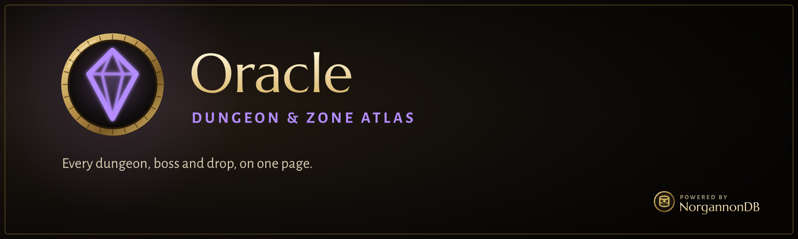

  

  
  
  

> [!WARNING]
> **Very much a work in progress.** This is an early build for WoW Forever (client 1.60.1), in
> active development and testing. Expect missing features, rough edges, bugs, and changes that
> break things between versions. Bug reports and feedback are welcome in
> [Issues](../../issues).

**Oracle is the atlas you open before you go.** Every dungeon and raid, every zone and every
profession, with the gear, drops and rewards each one holds, in one window that knows where you
are.

## What it does

### Dungeons and raids
- **Real maps of every classic dungeon and raid**, built from the game's own minimap art, with
  each boss where it stands, the entrance, and floor tabs where rooms stack. Zoom in with the
  mouse wheel and drag to look around. A clean hand-drawn schematic is one click away.
- **Every boss and its loot**: drop chances, the game's own tooltips, shift-click to link and
  ctrl-click to try it on. Each boss's loot folds away under its name so a raid stays readable.
- **The quests that send you there**, with their givers, requirements, rewards and experience.
  One click shows the giver on your map with Clairvoyance.
- **The facts you check before a run**: level range, group size, keys and attunements, and your
  lockout.
- **Opens where you are.** Step into an instance and Oracle is ready on the right wing.

### Zones
- **Every zone's world map, fully revealed**, with dungeon entrances, flight masters, innkeepers
  and rares pinned on it.
- **What you can get there**: the zone's quest rewards, what its creatures drop and what its
  vendors sell, best item level first, filtered to gear, recipes or everything.
- **The rest at a glance**: services, trainers, rares, herbs and ore, and the zone's quests by
  level.

### Professions
- **A skill ladder for every profession**: each recipe at the skill where you learn it, in the
  game's orange, yellow, green and grey for your own skill, with each recipe's ranges drawn
  alongside.
- **Everything a recipe takes**: what it makes, the reagents and where each comes from, and where
  to learn it, whether trainer, vendor, drop or quest.
- **WoW Forever's own recipes and numbers**, read from the game itself, so the healing potions are
  where Forever put them.

Oracle shows you the facts. It never tells you what to do next: there's no leveling or crafting
guide.

## The NorgannonDB suite

|   | Add-on | |
|:-:|---|---|
|  | **[Clairvoyance](https://github.com/zmarotrix/Clairvoyance)** | Quest helper: your objectives on the map, minimap and compass, and a modern tracker |
|  | **Oracle** | Dungeon and zone atlas: maps, bosses, loot, zones and professions |
|  | **[NorgannonDB](https://github.com/zmarotrix/NorgannonDB)** | The open game database underneath, with **[NorgannonDB Core](https://github.com/zmarotrix/NorgannonDB_Core)**, the shared runtime |
|  | **[NorgannonDB Collector](https://github.com/zmarotrix/NorgannonDBCollector)** | Help map Azeroth: improves the database while you play |
|  | Foresight | Planner. *Coming later* |
|  | Archivum | Look anything up in game. *Coming later* |

## Getting started

1. Download **Oracle**, **[NorgannonDB](https://github.com/zmarotrix/NorgannonDB)** and
   **[NorgannonDB Core](https://github.com/zmarotrix/NorgannonDB_Core)** (on each page: **Code →
   Download ZIP**).
2. Extract them into your WoW Forever `Interface/AddOns` folder, and remove the `-main` that
   GitHub adds to each folder's name, so you end up with `Oracle`, `NorgannonDB` and
   `NorgannonDB_Core`.
3. Start the game and type **`/oracle`**, or click Oracle's minimap button.

| Command | What it does |
|---|---|
| `/oracle` | open or close Oracle |
| `/oracle deadmines` | open an instance by name |
| `/oracle settings` | the settings (also under NorgannonDB in the game's Settings) |
| `/oracle edit` | the map editor: move bosses, place summoned ones, move rooms between floors |

Oracle works on its own and gets better with **Clairvoyance** installed: "Show on map" and "Track"
hand things to it, and Clairvoyance's quest menu opens quests in Oracle.

---

## Technical details

<b>Requirements</b>

- WoW Forever, client 1.60.1 (interface 16001)
- NorgannonDB 1.4 or newer, NorgannonDB Core 1.14 or newer

<b>Where the data comes from</b>

- Dungeons, bosses, loot, quests, zones and recipes: [NorgannonDB](https://github.com/zmarotrix/NorgannonDB).
- Dungeon maps: the game's own indoor minimap textures, drawn by file id. Oracle ships only tile
  ids and positions (`data/maps.lua`), never the art itself.
- Boss and entrance positions on the game maps: the [cmangos classic-db](https://github.com/cmangos/classic-db)
  (GPL-3.0), with thanks, plus corrections made with the map editor.
- Zone maps: the game's own world map art and its overlay tables (`data/reveal.lua`).

<b>Changes</b>

See [CHANGELOG.md](CHANGELOG.md).

<b>Licence</b>

Oracle is free to download and use. The source is published for transparency, but all rights are
reserved for now; see [LICENSE](LICENSE). Made by **Maro**.

